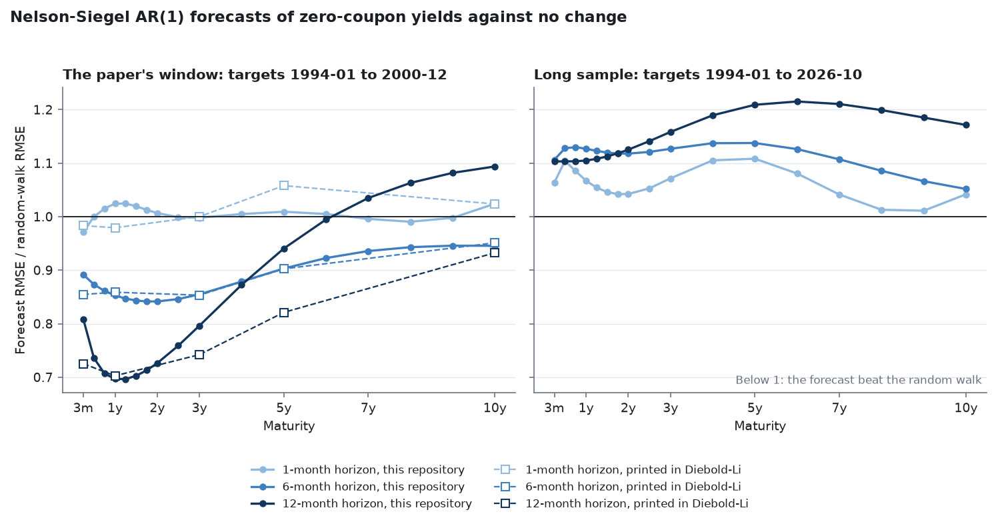
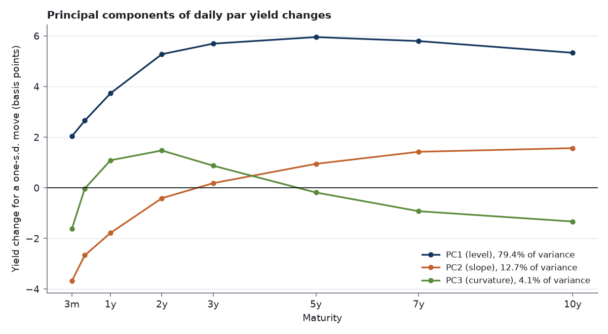
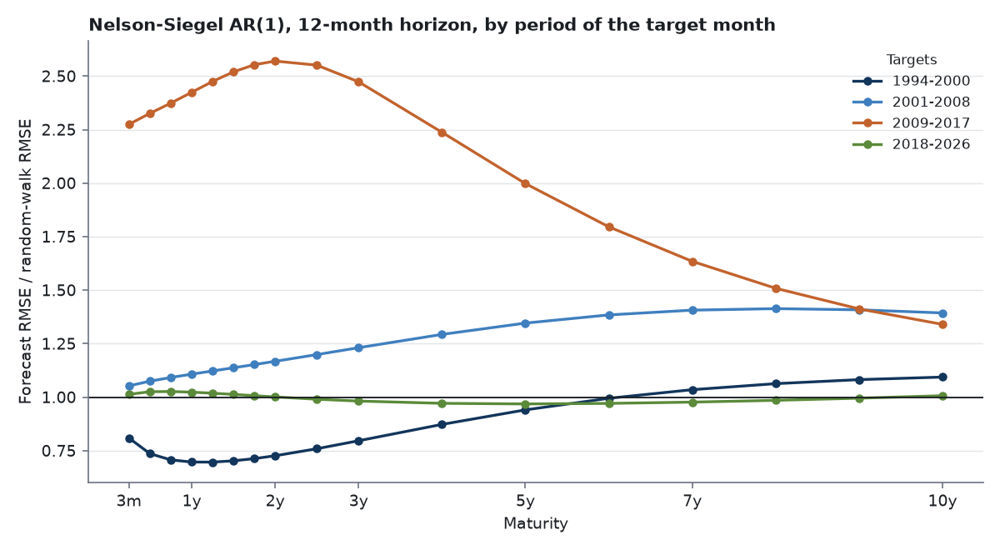

# Tenor

Thirty-seven years of daily Treasury yields: how many things are moving, and whether you can forecast them.

## Result

Three principal components explain 96.2% of the variance of daily changes in Treasury par yields from 1990 to 2026 (79.4%, 12.7% and 4.1%). The design expected about 99%; that figure only appears for monthly changes (98.5%) or for yield levels (99.95%).

The Diebold-Li forecast lost to "no change". For target months from January 1999 to October 2026, the Nelson-Siegel model with AR(1) factors had a higher RMSE than the random walk at all eight maturities and all three horizons, by 3% to 14%. At 1 and 6 months the random walk is better at the 5% level for 7 of 8 maturities. At 12 months, where the paper found its largest gains, the model is 7% to 14% worse and the difference is not significant.



The dashed line is the 12-month result printed in the paper for 1994 to 2000. This repository could not reproduce that line, because the Treasury's files start in 1990 and the paper's estimation starts in 1985. See "What did not replicate".

## Reproduce

```
uv sync
uv run python scripts/fetch_data.py
uv run python scripts/reproduce.py
```

The download is 37 small files and takes a few minutes because the Treasury's server is slow. The run itself takes about a second. `--fast` uses coarser rolling windows. `--synthetic --out <dir>` runs the whole pipeline on a simulated panel with no network, which is what CI does.

Results stop at 31 October 2026 whatever the download date, so a later run gives the same tables unless the Treasury revises old values.

## What was built

- Principal components of daily par yield changes: variance shares, loadings, the share explained at each maturity, and the shares over rolling five-year windows
- The same decomposition on weekly changes, monthly changes, monthly levels, the correlation matrix, and a panel that adds the 20- and 30-year points
- Nelson-Siegel fits for each month with the decay fixed at 0.0609, with residual and factor statistics
- Recursive forecasts at 1, 6 and 12 months from four models: Nelson-Siegel with AR(1) factors, Nelson-Siegel with VAR(1) factors, AR(1) on each yield, and the random walk
- Diebold-Mariano tests of each model against the random walk
- The same forecasts scored on three sub-periods and on the paper's own 1994 to 2000 window

## Findings in more detail

### Factors

| Data | First three components |
|---|---|
| Daily changes | 96.2% |
| Weekly changes | 97.4% |
| Monthly changes | 98.5% |
| Monthly levels | 99.95% |

The share depends on the maturity. Three components explain 96.5% to 98.7% of daily changes from 2 to 10 years, 91.4% at 1 year and 87.5% at 6 months. Bill yields have daily moves of their own.

The first component is not a parallel shift. A one-standard-deviation day moves the 3-month yield by 2.0 basis points and the 5-year by 6.0.



Over rolling windows of 1,250 trading days the three-component share stays between 94.1% and 97.4%. The split between the first two moves much more. The first component's share is below 75% in every window ending between October 2008 and August 2013, with a low of 70%, and is back at 90% by February 2014. Those are the windows that contain the autumn of 2008. From September to December 2008 the 3-month yield's daily changes had a standard deviation of 19 basis points, against 4.6 over the whole sample (a side calculation on the same panel, not one of the committed tables).


### Nelson-Siegel fit

The three-factor curve fits the eight par yields with an RMSE between 4 and 8 basis points by maturity. The fitted factors track the simple measures the paper compares them with: correlation 0.969 between the level factor and the 10-year yield, -0.995 between the slope factor and the 10-year minus 3-month spread, 0.998 for curvature. The paper reports 0.97, -0.99 and 0.99.

### Forecasts

RMSE of the Nelson-Siegel AR(1) forecast divided by the random walk's, 334 forecasts per cell:

| Horizon | 3m | 1y | 3y | 5y | 10y |
|---|---|---|---|---|---|
| 1 month | 1.062 | 1.092 | 1.069 | 1.049 | 1.040 |
| 6 months | 1.077 | 1.126 | 1.115 | 1.089 | 1.059 |
| 12 months | 1.074 | 1.108 | 1.142 | 1.139 | 1.107 |

Most of the 12-month loss comes from 2009 to 2017, when the model's RMSE was 1.3 to 2.2 times the random walk's. Short yields sat near zero and the autoregression kept forecasting a return to the historical mean. In 1999 to 2008 and in 2018 to 2026 the ratio is between 0.99 and 1.09: close to the random walk and not ahead of it.



The VAR(1) version does a little better than the random walk for 3- and 6-month yields at the 1- and 6-month horizons (ratios 0.93 to 0.98). None of those differences is significant.

## What did not replicate

- "About 99%" for three factors. Daily changes give 96.2%. Litterman and Scheinkman's 98.4% comes from a factor model on weekly returns of fitted zero-coupon bonds from 1984 to 1988. My weekly figure is 97.4%.
- The 12-month forecast gain. The paper's Nelson-Siegel forecasts had 7% to 30% lower RMSE than the random walk at 12 months. Here they have 7% to 14% higher RMSE.
- The paper's Table 6 on its own dates. With forecasts for 1994 to 2000 the random-walk RMSE here is within 0.05 percentage points of the paper's at every maturity and horizon, so the data are comparable. The model's 12-month RMSE is 1.4 to 2.0 against the paper's 0.74 to 0.98. The estimation sample here starts in 1990, five years after the paper's, and the first 12-month forecast rests on 25 regression pairs. That run says little about the paper either way.
- Two small numbers in the paper. A decay of 0.0609 puts the peak of the curvature loading at 29.45 months, where the paper says exactly 30. A coefficient printed as 0.00053 computes to 0.00038. Neither affects anything.

`PAPER.md` has the formulas with their source sections, every table beside the printed values, and the list of variants run.

## Sources

- Litterman and Scheinkman, "Common Factors Affecting Bond Returns", Journal of Fixed Income 1(1), 1991
- Diebold and Li, "Forecasting the term structure of government bond yields", Journal of Econometrics 130(2), 2006
- Diebold and Mariano, "Comparing Predictive Accuracy", Journal of Business and Economic Statistics 13(3), 1995, for the test statistic

## Data

The US Treasury's Daily Treasury Par Yield Curve Rates, one CSV per year from 1990, from `home.treasury.gov`. No key and no account. The files are downloaded into `data/` and are not committed or redistributed here.

The panel is the eight maturities published on every trading day since January 1990: 3 and 6 months, 1, 2, 3, 5, 7 and 10 years. That is 9,211 days and 442 month ends from 2 January 1990 to 30 October 2026. Four days with a missing value were dropped. `results/data_vintage.json` records a hash of the panel used.

## How it is tested

69 tests, run with `uv run pytest`. The maths was tested before any result was looked at.

- A panel built from three known orthogonal factors is decomposed back into those factors, with the eigenvalues, loadings and scores recovered
- Nelson-Siegel reproduces its own generated curves, has the limits the paper states, and its yield equals the average of its forward curve
- The slope and curvature coefficients printed in the paper are checked, including the one that does not match
- The direct h-step regression recovers a noiseless AR(1) and VAR(1) exactly
- Changing data after a forecast date leaves that forecast unchanged
- The random walk is scored on exactly the same origin and target dates as every model
- The Diebold-Mariano statistic matches a hand calculation and has close to nominal size under the null in simulation
- Running the pipeline twice gives byte-identical tables

`uv run ruff check` and `uv run mypy src` are clean.

## Layout

```
src/tenor/             the code
tests/                 maths tests first
scripts/reproduce.py   one command rebuilds every figure and table
scripts/fetch_data.py  downloads public data into data/ (never committed)
results/               committed figures and small tables
PAPER.md               citations, formulas, comparison with the sources
```

## Roadmap

- [x] Project skeleton, CI, and the reproduce command
- [x] Principal components of daily Treasury par yields: level, slope and curvature
- [x] The share of variance each factor explains, through time
- [x] Nelson-Siegel fits
- [x] Diebold-Li forecasts at 1, 6 and 12 months, against a random walk
- [x] `PAPER.md` comparison with the sources
- [x] Results and limits written up at the top of this file

The CI workflow is written and its steps pass locally on Windows. It has not been seen running on GitHub.

## Limits

- Par yields come from a curve the Treasury fits to indicative quotes, and the Treasury changed its fitting method on 6 December 2021. The papers use zero-coupon yields. Everything here is a model fitted to the output of another model.
- Eight maturities, with nothing between 3 and 5 years or beyond 10. The paper has seventeen. A three-parameter curve fitted to eight points leaves few degrees of freedom, and the fit residual is part of every forecast error the random walk does not have.
- The 3-month yield is missing on three days in December 2008, and the panel has no maturity under 3 months, so the factors say nothing about the very front of the curve.
- The paper's 1985 to 2000 sample cannot be rebuilt from the Treasury's download, which starts in 1990. The paper-window comparison here uses a shorter estimation history and should not be read as a test of the paper.
- The forecast result is one path of history. The 334 monthly targets include a seven-year stretch at the zero bound that an AR(1) around a fixed mean was never going to handle, and 12-month errors overlap, so the effective sample is much smaller than 334.
- The decay was fixed at the paper's 0.0609 and never re-estimated. No shadow-rate, regime or unit-root variant was tried.
- This is research code. It is not investment advice and it does not trade.

## The name

Tenor is the time left until a bond pays. The yield curve is one yield per tenor.

## Licence

MIT. See `LICENSE`.
