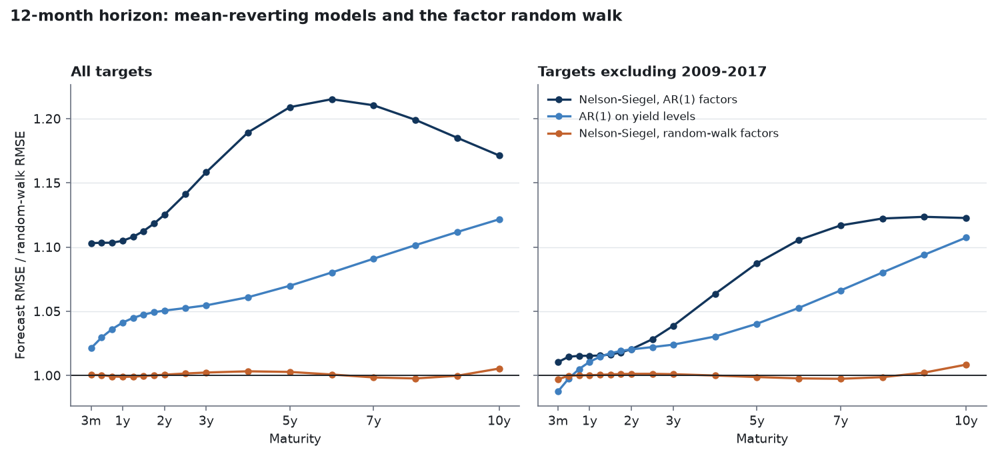
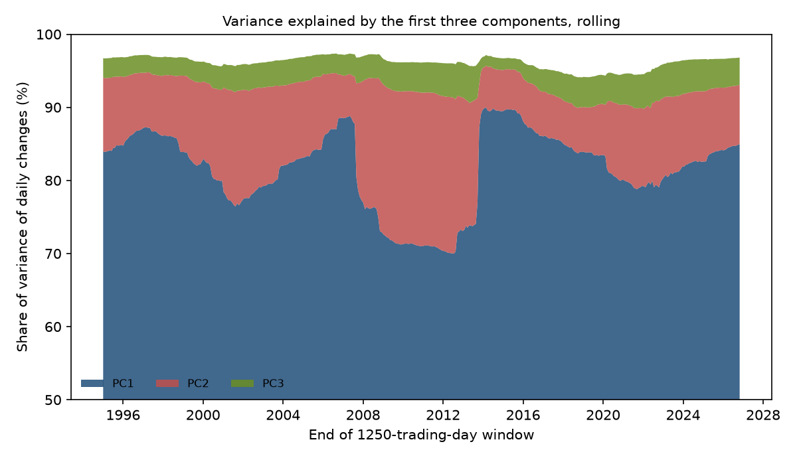

# Tenor

[](https://github.com/mal0ware/tenor/actions/workflows/ci.yml)

Does the Diebold-Li yield curve forecast beat "no change" once you leave the seven years it was published on?

## Result

On the paper's own window it does, and this repository reproduces that. Outside the window it does not.

Diebold and Li (2006) fit a three-factor Nelson-Siegel curve each month, forecast each factor with an AR(1), and report that the 12-month forecasts for 1994 to 2000 beat the random walk. I rebuilt their setup on the Federal Reserve's zero-coupon yields: the same seventeen maturities, estimation from January 1985, forecasts for January 1994 to December 2000. The random-walk RMSE lands within 0.04 percentage points of the paper's at every maturity and horizon it prints. At the five maturities the paper prints, the model's 6-month RMSE ratios to the random walk are 0.85 to 0.95 here and 0.85 to 0.95 in the paper. At 12 months they are 0.70 to 0.94 from 3 months to 5 years (paper: 0.70 to 0.82) and 1.09 at 10 years (paper: 0.93).

Scoring the same model and data on every month from January 1994 to October 2026 (394 forecasts) reverses the result. The model's RMSE is higher than the random walk's at all seventeen maturities and all three horizons: by 1% to 11% at 1 month, 5% to 14% at 6 months and 10% to 22% at 12 months.


Left: this repository's run of the paper's window (solid) beside the ratios from the paper's printed tables (dashed). Right: the long sample.

The loss comes from forecasting the factors back towards their historical means. A Nelson-Siegel forecast that leaves the factors where they are matches the random walk to within 0.5% at 12 months. Leaving out the zero-bound years 2009 to 2017 shrinks the 12-month loss to 1% to 12% and does not remove it.

The main limit: this is one path of history, and the tests cannot say much on it. On the paper's 84 forecasts no difference between the model and the random walk reaches the 5% level in either direction. At 12 months the tests used here reject a true null 11% to 15% of the time on a sample that short, so they are too eager and still find nothing.

## Reproduce

```
uv sync
uv run python scripts/fetch_data.py
uv run python scripts/reproduce.py
```

`fetch_data.py` downloads 37 small files from the Treasury and one 17 MB file from the Federal Reserve. The run takes about four seconds and writes `results/`. A second run gives byte-identical files.

`--fast` uses coarser rolling windows and fewer simulations and writes to `results_fast/`, which is not committed. `--synthetic --out <dir>` runs everything on simulated panels with no network, which is what CI does. Neither flag can write into `results/`.

Results stop at 31 October 2026 whatever the download date. The Fed's file is a staff research product and can be revised; `results/data_vintage.json` records a hash of each panel used.

## Data

Two public sources, no key and no account. Both are downloaded into `data/` and are not committed.

The forecasts use the Gürkaynak-Sack-Wright curve published by the Federal Reserve (`feds200628.csv`). It gives six Svensson parameters per business day from June 1961. I compute continuously compounded zero-coupon yields from those parameters at the paper's seventeen maturities, 3 to 120 months, and take the last day of each month: 502 months from January 1985 to October 2026. The yields I compute at whole years match the Fed's own tabulated columns to 0.0004 percentage points.

The principal components use the Treasury's daily par yield curve from `home.treasury.gov`: eight maturities quoted on every trading day since January 1990, 9,211 days. Four days with a missing value were dropped. The Fed's curve is a smooth six-parameter function, so its yields have at most six factors by construction and are no use for counting factors.

## Forecasts

### The paper's window

RMSE in percentage points, 84 forecasts, targets January 1994 to December 2000 (`results/forecast_paper_window.csv`):

| Horizon | Maturity | Random walk here | paper | Nelson-Siegel AR(1) here | paper | Ratio here | paper |
|---|---|---|---|---|---|---|---|
| 1 | 3m | 0.186 | 0.179 | 0.181 | 0.176 | 0.972 | 0.983 |
| 1 | 1y | 0.235 | 0.241 | 0.240 | 0.236 | 1.024 | 0.979 |
| 1 | 3y | 0.281 | 0.279 | 0.280 | 0.279 | 0.998 | 1.000 |
| 1 | 5y | 0.277 | 0.276 | 0.280 | 0.292 | 1.009 | 1.058 |
| 1 | 10y | 0.245 | 0.254 | 0.251 | 0.260 | 1.024 | 1.024 |
| 6 | 3m | 0.610 | 0.605 | 0.544 | 0.517 | 0.892 | 0.855 |
| 6 | 1y | 0.779 | 0.779 | 0.664 | 0.669 | 0.853 | 0.859 |
| 6 | 3y | 0.876 | 0.879 | 0.749 | 0.750 | 0.855 | 0.853 |
| 6 | 5y | 0.844 | 0.861 | 0.762 | 0.777 | 0.903 | 0.902 |
| 6 | 10y | 0.740 | 0.758 | 0.700 | 0.721 | 0.946 | 0.951 |
| 12 | 3m | 1.024 | 1.019 | 0.828 | 0.739 | 0.808 | 0.725 |
| 12 | 1y | 1.189 | 1.197 | 0.829 | 0.841 | 0.697 | 0.703 |
| 12 | 3y | 1.231 | 1.237 | 0.980 | 0.918 | 0.796 | 0.742 |
| 12 | 5y | 1.163 | 1.191 | 1.094 | 0.978 | 0.940 | 0.821 |
| 12 | 10y | 1.016 | 1.052 | 1.111 | 0.981 | 1.094 | 0.933 |

The model's RMSE is within 0.012 of the paper's at 1 month, 0.027 at 6 months and 0.130 at 12 months. The 1- and 6-month tables replicate. The 12-month table replicates in direction and size up to 3 years and falls short at 5 and 10 years, where the paper's model wins and mine ties or loses. The data explain some of that gap: the paper uses unsmoothed Fama-Bliss yields from CRSP, which are licensed, and the Fed's curve is a different estimate of the same yields.

The paper's Diebold-Mariano statistics at 12 months are -1.65, -2.04, -2.11, -1.61 and -0.63. The same statistic here is -0.73, -1.06, -0.88, -0.30 and +0.57. The paper does not say how it estimated the variance, so I cannot tell how much of that difference is method.

### The long sample

Nelson-Siegel AR(1) RMSE divided by the random walk's, 394 forecasts, targets January 1994 to October 2026 (`results/forecast_vs_random_walk.csv`):

| Horizon | 3m | 1y | 3y | 5y | 10y |
|---|---|---|---|---|---|
| 1 month | 1.064 | 1.067 | 1.072 | 1.108 | 1.042 |
| 6 months | 1.106 | 1.127 | 1.127 | 1.138 | 1.052 |
| 12 months | 1.103 | 1.105 | 1.158 | 1.209 | 1.171 |

By period of the target month, 12-month horizon:

| Targets | Forecasts | 3m | 1y | 3y | 5y | 10y |
|---|---|---|---|---|---|---|
| 1994 to 2000 | 84 | 0.808 | 0.697 | 0.796 | 0.940 | 1.094 |
| 2001 to 2008 | 96 | 1.053 | 1.107 | 1.231 | 1.346 | 1.394 |
| 2009 to 2017 | 108 | 2.275 | 2.424 | 2.473 | 1.998 | 1.340 |
| 2018 to 2026 | 106 | 1.013 | 1.023 | 0.982 | 0.968 | 1.007 |


The model wins in the paper's window, loses in the next two periods and ties in the last. Its mean 12-month error is between -0.7 and -1.2 percentage points at every maturity in 2001 to 2008 and between -0.6 and -1.0 in 2009 to 2017: it kept forecasting a return to the higher yields of its estimation sample while yields fell and then sat near zero.

The split into these four periods was chosen after I had seen the earlier par-yield results, which already showed 2009 to 2017 as the worst stretch. Treat it as post hoc.

### Is it the model or the mean reversion?

Three 12-month comparisons on the long sample separate the pieces (`results/fig_forecast_variants.png`).

| Forecast | Ratio to random walk, all targets | Without 2009 to 2017 |
|---|---|---|
| Nelson-Siegel, factors left unchanged | 0.998 to 1.005 | 0.997 to 1.008 |
| AR(1) on each yield, no curve | 1.021 to 1.122 | 0.988 to 1.107 |
| Nelson-Siegel, AR(1) factors | 1.103 to 1.215 | 1.010 to 1.124 |

Ranges are over the seventeen maturities.



Fitting the curve costs almost nothing: today's fitted curve forecasts as well as today's yields. A plain AR(1) on each yield, with no curve at all, loses to the random walk in the same way as the factor model. So the loss belongs to the assumption that yields return to a fixed mean, estimated on a sample that starts in 1985. The zero-bound years make it much worse and are not the whole of it, since 2001 to 2008 loses by 5% to 41% on its own.

Both of these variants were added after the first results and are post hoc.

### What the tests can and cannot say

The first version of this repository reported Diebold-Mariano statistics with normal critical values for every comparison. That was wrong for two reasons, and `results/test_size_simulation.csv` measures both.

The AR(1) on yields contains the random walk as a special case. When the random walk is true, the larger model is expected to lose because it estimates parameters it does not need, and the Diebold-Mariano statistic is not normal. In a simulation of exactly that case with 394 one-month forecasts, the AR(1) has the higher RMSE 91% of the time and the test declares the random walk better at the 5% level 19% of the time. For nested pairs this repository now reports the Clark-West test, which is one-sided and can only reject in favour of the larger model.

At longer horizons the errors overlap. With 84 forecasts at 12 months the uncorrected statistic rejects a true null 17% of the time. The Harvey-Leybourne-Newbold correction brings that to 11%, and to 6% with 394 forecasts. All p-values here use that correction. The Bartlett window with the same lag length is worse (15% and 11%), which is why the two windows disagreed in the earlier tables.

With that in place:

- Nelson-Siegel AR(1) against the random walk, long sample. These two are not nested, so the corrected Diebold-Mariano test applies under recursive estimation. The model is worse at the 5% level at 14 of 17 maturities at 1 month, 1 at 6 months and 4 at 12 months.
- The same comparison with a rolling 108-month estimation window, where the Giacomini-White argument makes the test valid for any pair of forecasting methods (`results/forecast_rolling_scheme.csv`). The model is worse at 14, 11 and 4 of 17 maturities.
- On the paper's window, neither scheme gives a 5% rejection at any maturity or horizon, in either direction.
- Clark-West, Nelson-Siegel AR(1) against the same curve with unchanged factors (`results/forecast_nested_tests.csv`). The AR(1) dynamics help at the 5% level in 1 of 51 cells on the paper's window and 2 of 51 on the long sample, about what chance gives.
- Clark-West, AR(1) on yields against the random walk. On the paper's window it rejects in favour of the AR(1) at 6 of 17 maturities at 6 months and 10 of 17 at 12 months, and nowhere on the long sample. The test over-rejects on a sample that short (11% and 15% in the simulation), so this is weak evidence.

I read this as: the model is reliably worse than the random walk at 1 month over 33 years, and the 12-month comparisons in both directions are within what one path of overlapping errors can produce.

### Par yields

The same four models on the Treasury's par yields, eight maturities, estimation from 1990 and targets from January 1999 to October 2026 (334 forecasts), give the same answer: the Nelson-Siegel AR(1) loses at every maturity and horizon, by 3% to 14%. Those rows have `panel = par` in the forecast tables.

## Factors

Three principal components explain 96.2% of the variance of daily changes in Treasury par yields from 1990 to 2026 (79.4%, 12.7% and 4.1%).

| Data | First three components |
|---|---|
| Daily changes | 96.2% |
| Weekly changes | 97.4% |
| Monthly changes | 98.5% |
| Monthly levels | 99.95% |

The share depends on the maturity. Three components explain 96.5% to 98.7% of daily changes from 2 to 10 years, 91.4% at 1 year and 87.5% at 6 months. Bill yields have daily moves of their own.

The first component is not a parallel shift. A one-standard-deviation day moves the 3-month yield by 2.0 basis points and the 5-year by 6.0.


Over rolling windows of 1,250 trading days the three-component share stays between 94.1% and 97.4%. The split between the first two moves much more. The first component's share is below 75% in every window ending between October 2008 and August 2013, with a low of 70.0% in July 2012. It then recovers to its highest value in the sample, 89.96%, in the window ending 25 February 2014. The low windows are the ones that contain the autumn of 2008. From September to December 2008 the 3-month yield's daily changes had a standard deviation of 19.1 basis points, against 4.6 over the whole sample (`results/pca_bill_volatility.csv`).



Litterman and Scheinkman's often-quoted 98.4% for three factors comes from a factor model on weekly returns of fitted zero-coupon bonds from 1984 to 1988. Plain principal components on daily par yield changes give less, and the gap closes as the frequency falls.

On the par yields the Nelson-Siegel curve fits with an RMSE of 4 to 8 basis points by maturity. The fitted factors track the simple measures the paper compares them with: correlation 0.969 between the level factor and the 10-year yield, -0.995 between the slope factor and the 10-year minus 3-month spread, and 0.998 for curvature. The paper reports 0.97, -0.99 and 0.99.

## Limits

- The Fed's curve is fitted to notes and bonds and leaves out bills. Its yields below about one year are an extrapolation of a smooth curve. The 3- and 6-month columns here are less trustworthy than the rest, although the 3-month random-walk RMSE still matches the paper's to 0.007.
- The paper's data are unsmoothed Fama-Bliss yields. Fitting a three-factor curve to seventeen points read off a six-parameter curve is an easier job than the paper's, with residuals of 1 to 9 basis points.
- The forecast result is one path of history. 394 monthly targets with 12-month overlap hold about 33 independent 12-month errors, and the sample includes one long decline in yields and one seven-year stretch at the zero bound.
- The decay parameter was fixed at the paper's 0.0609 and never re-estimated. No shadow-rate, regime-switching or unit-root variant of the factor dynamics was tried, beyond leaving the factors unchanged.
- The paper has ten competitor models. Two are implemented here, the random walk and the AR(1) on yields, plus the paper's Nelson-Siegel VAR(1).
- Two small numbers in the paper do not compute. A decay of 0.0609 puts the peak of the curvature loading at 29.45 months, where the paper says exactly 30, and a coefficient printed as 0.00053 computes to 0.00038. Neither affects anything.
- This is research code. It is not investment advice and it does not trade.

`PAPER.md` has the formulas with their source sections, the full comparison with the printed tables, and the list of everything that was run.

## Tests

100 tests, run with `uv run pytest`. `uv run ruff check` and `uv run mypy src` are clean.

- A panel built from three known orthogonal factors is decomposed back into those factors
- Nelson-Siegel reproduces its own generated curves and its yield equals the average of its forward curve; the same check is run on the Svensson formula used for the Fed's parameters
- The direct h-step regression recovers a noiseless AR(1) and VAR(1) exactly
- Changing data after a forecast date leaves that forecast unchanged, and a rolling window ignores data before the window
- The random walk is scored on exactly the same origin and target dates as every model
- The Diebold-Mariano, Harvey-Leybourne-Newbold and Clark-West statistics match hand calculations
- Test size is simulated at 6 and 12 months, including the nested case where Diebold-Mariano misleads
- `--fast` and `--synthetic` refuse to write into `results/`
- Running the pipeline twice gives byte-identical tables

## Layout

```
src/tenor/             the library: data readers, PCA, Nelson-Siegel, forecasts, tests, pipeline
tests/                 unit tests and a pipeline run on simulated panels
scripts/fetch_data.py  downloads the two public data sets into data/ (never committed)
scripts/reproduce.py   rebuilds every figure and table
results/               committed figures and tables
PAPER.md               sources, formulas, full comparison, everything that was run
```

## Sources

- Diebold and Li, "Forecasting the term structure of government bond yields", Journal of Econometrics 130(2), 2006
- Litterman and Scheinkman, "Common Factors Affecting Bond Returns", Journal of Fixed Income 1(1), 1991
- Gürkaynak, Sack and Wright, "The U.S. Treasury yield curve: 1961 to the present", Journal of Monetary Economics 54(8), 2007
- Diebold and Mariano, "Comparing Predictive Accuracy", Journal of Business and Economic Statistics 13(3), 1995
- Harvey, Leybourne and Newbold, "Testing the equality of prediction mean squared errors", International Journal of Forecasting 13(2), 1997
- Clark and West, "Approximately normal tests for equal predictive accuracy in nested models", Journal of Econometrics 138(1), 2007
- Giacomini and White, "Tests of Conditional Predictive Ability", Econometrica 74(6), 2006

Tenor is the time left until a bond pays; the yield curve is one yield per tenor.

## Licence

MIT. See `LICENSE`.
